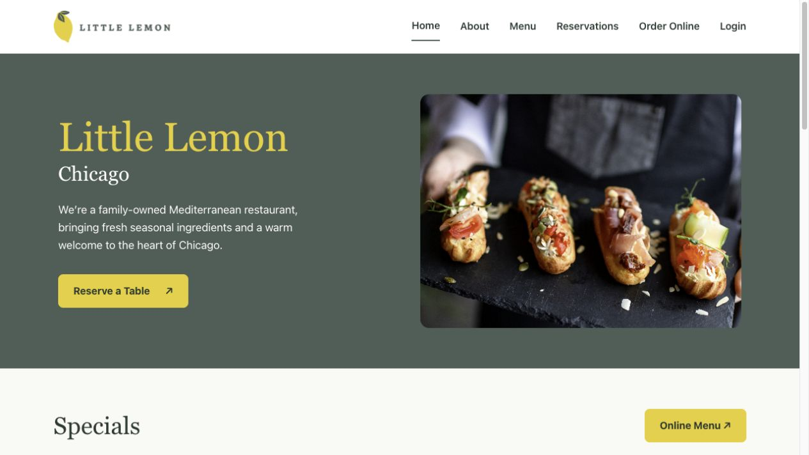
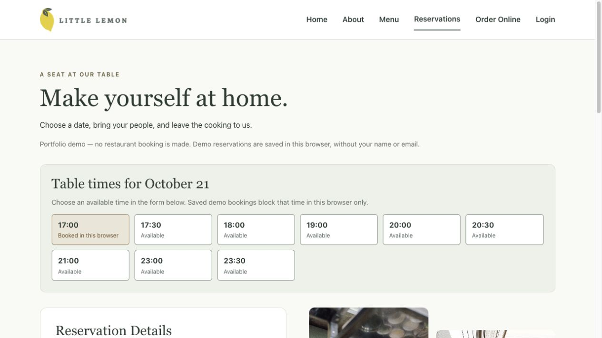

# Little Lemon

A React restaurant demo adapted from an existing Little Lemon capstone project, with reservation validation, responsive layouts, accessible form feedback, and route tests. Refreshed in October 2026.



## Run locally

Use **Node 24** (24.15 or newer within the 24.x series). `.nvmrc` pins the verified version, 24.19.0. Node 18 is no longer supported by this project's tooling. If you use nvm, run `nvm install` and `nvm use` in this folder first.

```sh
npm ci
npm start
```

Open http://127.0.0.1:3010. The app uses React 18, React Router 7, Vite 8, and Vitest 5. JSX components use `.jsx` filenames. `index.html` is at the project root, and `src/main.jsx` mounts the app.

```sh
npm test
npm run build
npm run preview
```

Tests run once with `npm test`; `npm run test:watch` starts watch mode. Production files are written to `dist/`. The production preview runs at http://127.0.0.1:3011, separately from the development server. Browser storage belongs to its origin, so demo bookings do not transfer between ports or between localhost and 127.0.0.1. Vite's preview is for checking a build locally, not a production hosting service.

## Features

- Responsive home, menu, about, reservation, and confirmation views.
- Date-dependent simulated availability, React reducer state, and controlled form inputs.
- Shared available/booked slot list and browser-local reservation receipts.
- Refresh-safe confirmation and a reset button to clear demo bookings.
- Validation for dates, available times, whole-number party sizes (1–12), occasions, and seating.
- Labeled controls, associated validation messages, keyboard focus styles, skip link, and accessible mobile navigation.
- Safe empty confirmation and unknown-route screens.
- Unit and integration tests for validation, customer details, date changes, successful booking, rejected submission, and routes.

## Demo boundaries

Availability and submission are local simulations in `src/api.js`. No booking is sent to a restaurant, no email is sent, and no account, payment, delivery service, or backend is connected. Reviews are sample content. Reservation receipts are saved in localStorage for this browser and origin. Names and email addresses are validated but are not saved in localStorage or navigation state. Confirmation survives reloads; Reset demo bookings clears the saved receipts. Clearing browser data also removes them. Legacy login and ordering URLs explain these limits rather than presenting nonfunctional forms.

Static hosting must rewrite application routes to `index.html` for direct links to work. Nothing has been deployed by this repair.

## Project origin and attribution

This version continues the existing [FRowe8/little-lemon](https://github.com/FRowe8/little-lemon) project inspired by the [Meta Front-End Developer Capstone](https://www.coursera.org/learn/meta-front-end-developer-capstone). It retains inherited components, Little Lemon branding, and supplied image assets. The original Create React App/Jest setup has been migrated to Vite/Vitest, and routing has been updated to React Router 7. The repair and documentation were AI-assisted. This repository is an adaptation, not a claim of sole authorship of the original project or course assets.

## Validation and limitations

The migrated app passed 36 automated tests under Vitest and a production build under Vite. A clean `npm ci` completed from the lockfile; its dependency audit reported zero known vulnerabilities at this checkpoint (October 19, 2026). This is not a guarantee of application security. A local mobile browser check verified navigation and completion of a simulated reservation. This is not a production booking system or a complete accessibility audit. Availability is deterministic sample data based on the day of month; saved demo bookings consume a time in this browser only. Availability is not shared across devices, simultaneous-tab writes are not atomic, and same-day times are not filtered against the current clock.

## Course alignment review

Reviewed against the signed-in Meta capstone assessment and solution guide in October 2026. The app includes the booking fields, customer first/last name and email, required-field feedback, confirmation, parent-managed availability, and form tests. It also supplies semantic page structure, responsive styles, and Open Graph metadata. The live Capstone Wireframe was reviewed: homepage section order and the six navigation destinations match. The occasion options match the Capstone Components examples. The Specials and Testimonials headings and overlapping about photos also follow the wireframe. Typography, spacing, footer details, and the native dropdown styling still differ; this is not a pixel-for-pixel reproduction.

The implementation uses one reservation form instead of separate booking/customer-detail screens, and `BookingPage` owns availability rather than a component named `Main`. The course-style API functions are bundled locally instead of loaded from an external script. Browser persistence and a separate BookingSlot list are implemented. The saved receipt contains a generated ID, date, time, guest count, occasion, and seating choice. Navigation passes only the ID; confirmation reads the saved receipt. Use fictional customer details for the form.

## Reservation preview


